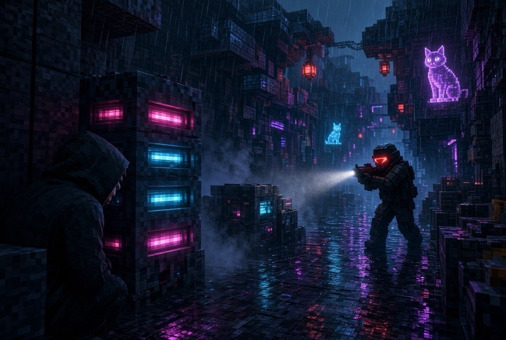
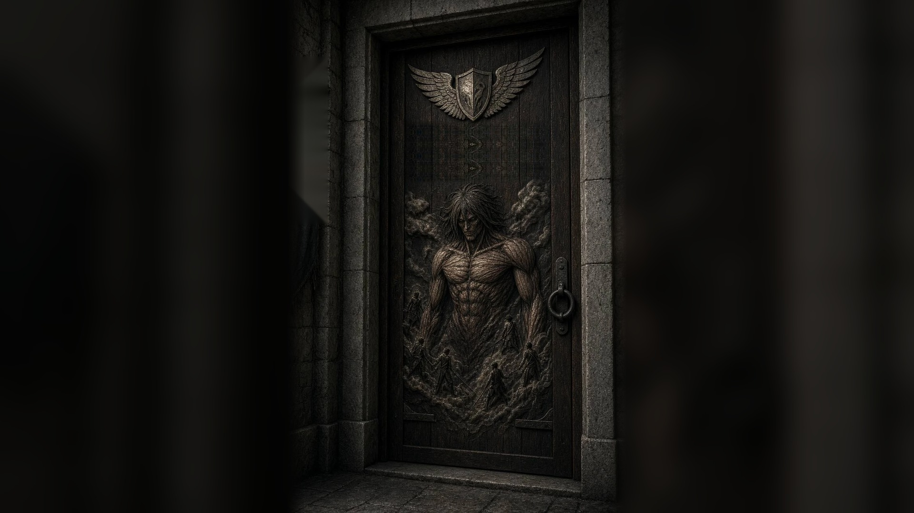
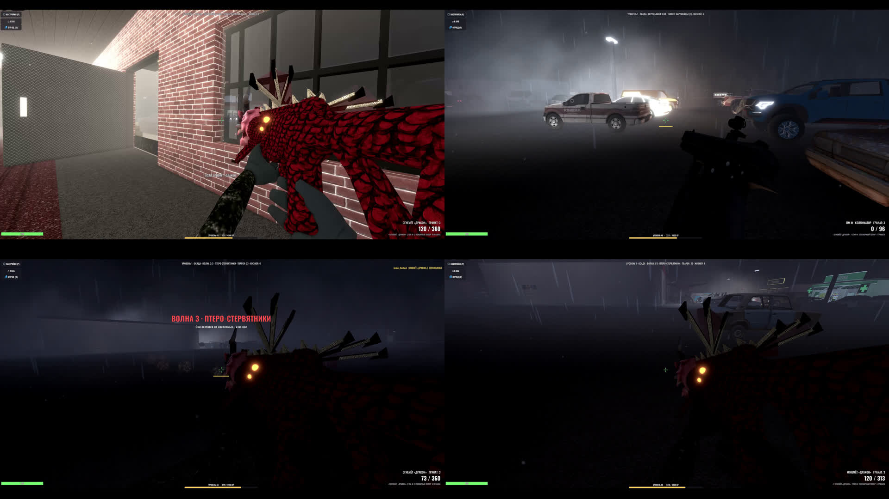
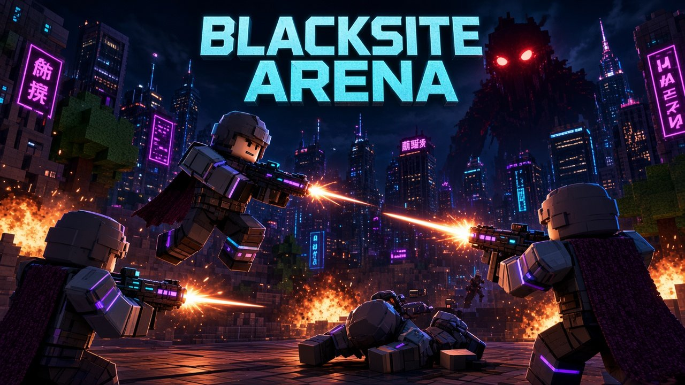
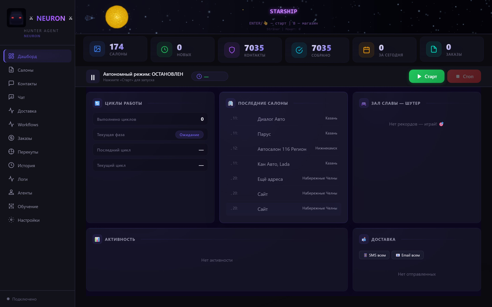

# Вагизов Артур · Jordan_Nortan

**Разработчик игр · ИИ-автоматизация · Веб**

Набережные Челны · удалёнка

---

Собираю продукты целиком: от шутеров на Godot/Roblox и браузерных арен до локальных LLM-агентов, CRM-ботов и лендингов с 3D. Люблю доводить до запускаемого демо, а не до «папки с набросками».

> **Исходный код — по запросу / демо на созвоне.**  
> В открытом доступе — витрина навыков и результатов, без публичных репозиториев с кодом.

---

## Навыки

---

## Игры

  
  

  
  

- **Blacksite Arena (Godot 4)** — шутер с кампанией, онлайн-режимами, кастомным оружием и боссами; PC + mobile-сборка.
- **Blacksite Arena (Roblox)** — опубликованная арена на Luau: скины, Game Pass, viewmodel, touch-UI.
- **Neon Orbit** — сетевой киберпанк FPS/TPS на Godot 4: лунная гравитация, 5v5 deathmatch.
- **ArenaMOBA / MOBA Mini** — браузерные MOBA на HTML5 Canvas (+ FastAPI для мини-версии).
- **Games Hub** — хаб мини-игр (FastAPI + SQLite).

---

## ИИ и автоматизация

  

- **AI Orchestrator** — локальная оркестрация агентов: планирование через Qwen/Ollama, код, vision, STT/TTS, связка с Godot.
- **Hunter Agent** — SaaS-хантер автосалонов: поиск, CRM, email/SMS, Docker, веб-панель.
- **Jarvis** — локальный ИИ-«директор» на Ollama: задачи, KPI, голос, веб-UI.
- **Столовая AI** — учёт продуктов: веб + Telegram-бот, SQLite, локальный AI.
- Пайплайны на **n8n**, аддоны и MCP под Blender.

---

## Приложения и сервисы

- **SuperApp** — Flutter-приложение с Node.js-бэкендом: музыка, чаты, локальный Jarvis.
- **VK Service App** — мини-приложение ВКонтакте для заявок и услуг.
- **Room Sense** — MVP присутствия в комнате по Wi‑Fi CSI (ESP32), без камер.
- **Antivirus Scanner** — учебный/локальный сканер на Python с веб-интерфейсом.

---

## Сайты

- **Blacksite Arena Site** — лендинг игры: React, Vite, Tailwind, Framer Motion, 3D model-viewer.
- **NEURON** — маркетинг/бренд на Next.js 15 + TypeScript + анимации.
- **Car Disassembly** — премиальный 3D teardown-скролл на Three.js.
- **nortan-site** — портфолио-лендинг с 3D-авто.

---

## Как смотреть работы

Исходный код в открытый GitHub не выкладываю.  
Могу показать демо на созвоне, прислать билд/запись или обсудить код под NDA.

**Почта:** [vagizovartur882@gmail.com](mailto:vagizovartur882@gmail.com)  
**Локация:** Набережные Челны · открыт к удалёнке
